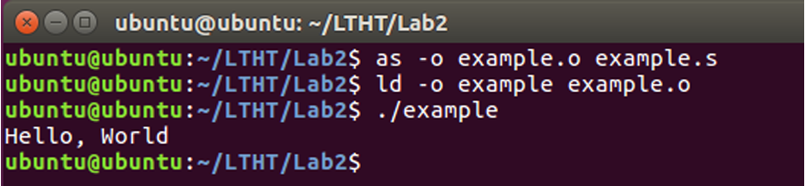

# Yêu cầu
Chạy trên hệ điều hành **ubuntu**
Sinh viên thực hiện viết các chương trình dưới dạng hợp ngữ (assembly) trong các file .s, sau đó thực hiện các bước hợp dịch và liên kết như sau: 
```bash
as -o example.s example.o
ld -o example example.s
./example
```

# Quy ước nhập/xuất (bắt buộc – bài nộp được chấm bằng bộ kiểm thử tự động): 
Chương trình viết theo cú pháp AT&T, kiến trúc 32-bit, dùng system call int 
$0x80. 
Khi hợp dịch/liên kết cần thêm cờ --32 (as) và -m elf_i386 (ld), ví dụ: 
```bash
as --32 -o bai.o bai.s && ld -m elf_i386 -o bai bai.o && ./bai. 
```
Mọi input nhập từ bàn phím (stdin), mỗi giá trị trên một dòng (kết thúc bằng 
Enter). 
Khi đọc bằng sys_read (%eax = 3), đặt %edx = đúng số b