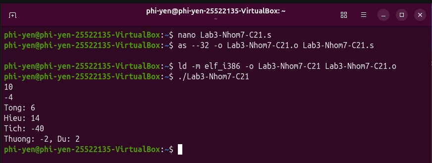
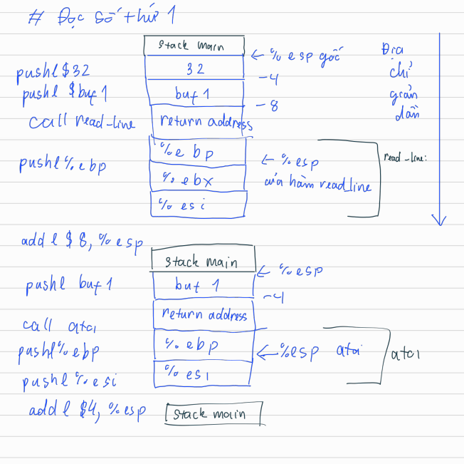
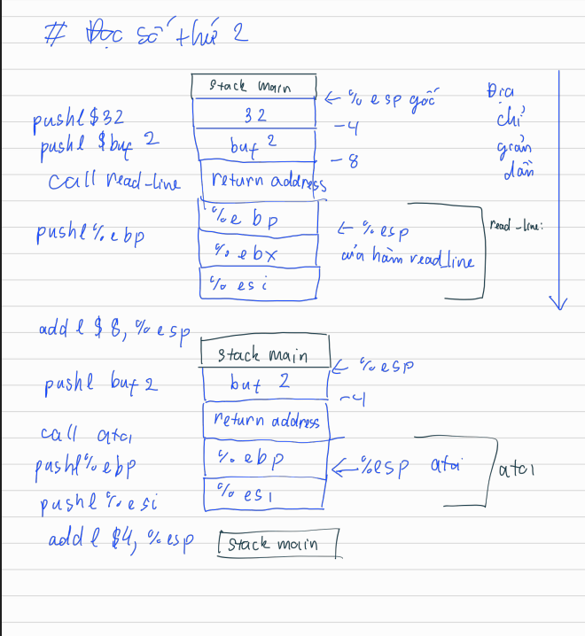
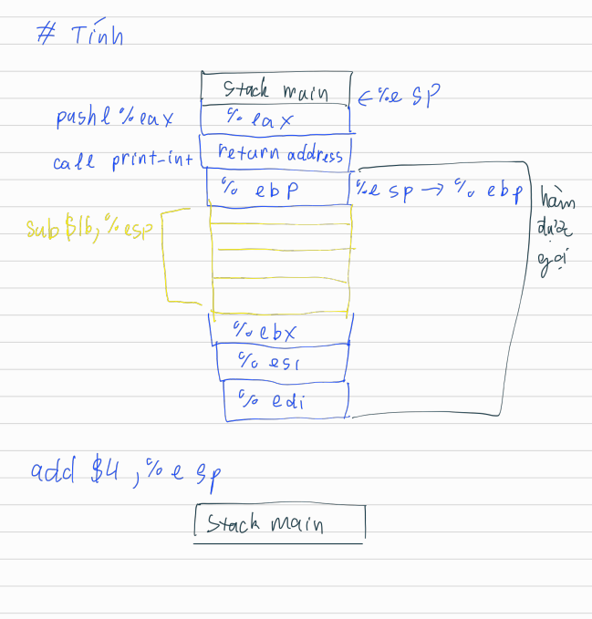

# Yêu cầu C1 lab 3
## Code
```
.section .data
#Cac loai thong bao ra man hinh
msg_tong: .string "Tong: "
len_tong = . - msg_tong - 1

msg_hieu: .string "\nHieu: "
len_hieu = . - msg_hieu - 1

msg_tich: .string "\nTich: "
len_tich = . - msg_tich - 1

msg_thuong: .string "\nThuong: "
len_thuong = . - msg_thuong - 1

msg_du: .string ", Du: "
len_du= . - msg_du - 1

msg_div: .string "\nKhong chia duoc cho 0\n"
len_div= . - msg_div - 1

newline: .string "\n"		#Xuong dong

.section .bss
.lcomm buf1, 32			#Chuoi so 1
.lcomm buf2, 32			#Chuoi so 2
.lcomm numA, 4			#So nguyen thu 1
.lcomm numB, 4			#So nguyen thu 2

.section .text

.globl _start

_start:
	#---Doc so thu 1
	pushl $32		#Day kich thuoc buffer (32) vao stack
	pushl $buf1		#Day dia chi buf1 vao stack
	call read_line		#Ham doc chuoi tu ban phim
	addl $8, %esp		#Don dep stack 8 bytes

	pushl $buf1		#Day buf1 vao stack
	call atoi		#Ham chuyen chuoi thanh so nguyen
	addl $4, %esp		#Don dep stack 4 bytes
	movl %eax, numA		
 
	#---Doc so thu 2 [Tuong tu nhu so 1]
	pushl $32
        pushl $buf2
        call read_line
        addl $8, %esp

        pushl $buf2
        call atoi
        addl $4, %esp
        movl %eax, numB


	#---Tinh+in tong a+b
	movl $4, %eax		#Sys_write
	movl $1, %ebx		#stdout
	movl $msg_tong, %ecx
	movl $len_tong, %edx 	
	int $0x80		#In ra	

	movl numA, %eax
	addl numB, %eax
	pushl %eax		#Day ket qua vao stack lam tham so
	call print_int
	addl $4, %esp

	#---Tinh+in hieu a-b
        movl $4, %eax
        movl $1, %ebx
        movl $msg_hieu, %ecx
        movl $len_hieu, %edx
        int $0x80

        movl numA, %eax
        subl numB, %eax
        pushl %eax
        call print_int
        addl $4, %esp

	#---Tinh+in tich a*b
        movl $4, %eax
        movl $1, %ebx
        movl $msg_tich, %ecx
        movl $len_tich, %edx
        int $0x80

        movl numA, %eax
        imull numB, %eax
        pushl %eax
        call print_int
        addl $4, %esp

	#---Tinh+in thuong a/b va so du a%b
	#------Kiem tra chia cho 0
	cmpl $0, numB
	je div_zero
	
	#------Tinh va in ra thuong
	movl $4, %eax
        movl $1, %ebx
        movl $msg_thuong, %ecx
        movl $len_thuong, %edx
        int $0x80

      	movl numA, %eax
	cltd 			#Mo rong %eax thanh %edx:%eax
	idivl numB 		#Chia %edx:%eax cho numB, %edx=du, %eax=thuong
	movl %edx, %esi
	
	pushl %eax
	call print_int
	addl $4, %esp

	#------In ra du
	movl $4, %eax
	movl $1, %ebx
	movl $msg_du, %ecx
	movl $len_du, %edx
	int $0x80

	pushl %esi
	call print_int
	addl $4, %esp

	movl $4, %eax
        movl $1, %ebx
        movl $newline, %ecx
        movl $1, %edx
        int $0x80
	
	jmp sys_exit		#Ket thuc code

#Xu li khi A chia cho 0
div_zero: 
	movl $4, %eax	
	movl $1, %ebx
	movl $msg_div, %ecx
	movl $len_div, %edx
	int $0x80
	jmp sys_exit

#In xuong dong
print_exit:
	movl $4, %eax
	movl $1, %ebx
	movl $newline, %ecx	#Xuong dong
	movl $1, %edx		#Xuong 1 byte
	int $0x80

#Ket thuc chuong trinh
sys_exit:
	movl $1, %eax
	xorl %ebx, %ebx		#Tra ve ma loi 0
	int $0x80


read_line:
	pushl %ebp		#Luu ebp cu cua ham goi
	movl %esp, %ebp		#Thiet lap con tro stack moi
	pushl %ebx		#Bao toan ebx
	pushl %esi		#Bao toan esi
		
	movl 8(%ebp), %esi	#Tham so 1(buf) luu vao esi
	movl 12(%ebp), %ecx	#Tham so 2(max_len) luu vao ecx
	decl %ecx		#Tru 1 cho o cuoi luu \0
	xorl %ebx, %ebx		#Khoi tao bien dem so byte ebx=0

read_loop:
    	cmpl %ecx, %ebx		#So sanh so byte da doc, oke thi end
    	jge read_done

    	pushl %ebx		#Luu ebx
    	movl $3, %eax		#sys_read
    	movl $0, %ebx		#stdin
    	leal (%esi), %ecx	
    	addl (%esp), %ecx
    	movl $1, %edx		#Read tung byte
    	int $0x80	
    	popl %ebx		#Khoi phuc ebx
	
    	cmpl $0, %eax		#Kiem tra read het chua
    	jle read_done

    	movb (%esi, %ebx, 1), %al #Kiem tra neu la enter -> stop
    	cmpb $10, %al
    	je read_done

    	incl %ebx
    	jmp read_loop 		#Read tiep

read_done:
    	movb $0, (%esi, %ebx, 1) #Them \0 cuoi buffer
    	popl %esi
    	popl %ebx
    	movl %ebp, %esp
    	popl %ebp
    	ret

#Chuyen ky tu so thanh so nguyen
atoi:
    	pushl %ebp
    	movl %esp, %ebp
    	pushl %ebx
    	pushl %esi

    	movl 8(%ebp), %esi	#Lay dia chi chuoi can doi
    	xorl %eax, %eax		#%eax=0
    	xorl %ecx, %ecx		#%ecx la so duong=0, am=1

    	movb (%esi), %bl	#Ki tu dau tien cua chuoi
    	cmpb $45, %bl		#So sanh co dau am khong
    	jne parse_loop
    	movl $1, %ecx		#eax=1 (so am)
    	incl %esi		

#Kiem tra cac truong hop ket thuc chuoi
parse_loop:
    	movzbl (%esi), %ebx
    	cmpb $0, %bl		#\0
    	je atoi_done
    	cmpb $10, %bl		#\n
    	je atoi_done
    	cmpb $48, %bl		#Nho hon ascii 48 la so 0
    	jl atoi_done
    	cmpb $57, %bl		#Lon hon acsii 57 la so 9
   	jg atoi_done

    	subl $48, %ebx		#Chuyen acsii sang so
    	imull $10, %eax
    	addl %ebx, %eax
    	incl %esi
    	jmp parse_loop

#Kiem tra neu la so am thi doi dau #eax 
atoi_done:
    	cmpl $1, %ecx
    	jne atoi_exit
    	negl %eax

atoi_exit:
    	popl %esi
    	popl %ebx
    	movl %ebp, %esp
    	popl %ebp
    	ret

print_int:
    	pushl %ebp
    	movl %esp, %ebp
    	subl $16, %esp		#16 bytes stack tam luu chuyen doi
    	pushl %ebx
    	pushl %esi
    	pushl %edi

    	movl 8(%ebp), %eax	#Lay so can in
    	leal -1(%ebp), %esi	#Con tro ve cuoi stack
    	movb $0, (%esi)

    	xorl %edi, %edi		#Kiem tra flag so am
    	cmpl $0, %eax
    	jge convert_loop
    	movl $1, %edi
    	negl %eax

convert_loop:
    	xorl %edx, %edx		#Delete edx chuan bi chia lay du
    	movl $10, %ebx
    	divl %ebx
    	addl $48, %edx		#Chuyen so du sang ascii

    	decl %esi
    	movb %dl, (%esi)

    	cmpl $0, %eax
    	jg convert_loop

    	cmpl $1, %edi		#Kiem tra so am
    	jne print_out
    	decl %esi
    	movb $45, (%esi)	

print_out:
    	leal -1(%ebp), %edx	#Do dai chuoi can in
    	subl %esi, %edx

    	movl $4, %eax		#sys_write(4)
    	movl $1, %ebx		#stdout
    	movl %esi, %ecx	
    	int $0x80

    	popl %edi
    	popl %esi
    	popl %ebx
    	movl %ebp, %esp
    	popl %ebp
    	ret
```


---
## Giải thích
### 1. Khai báo dữ liệu (`.section .data` và `.section .bss`)
- `.data`: Chứa các chuỗi văn bản thông báo để in ra màn hình như "Tong: ", "Hieu: ", "Tich: ", "Thuong: ", ", Du: ", thông báo lỗi chia cho 0 "Khong chia duoc cho 0\n", và các độ dài tương ứng (`len_...`).
- Biến chưa khởi tạo:
* `buf1`, `buf2` (32 bytes): Bộ nhớ đệm dùng để lưu chuỗi ký tự nhập vào từ bàn phím.
* `numA`, `numB` (4 bytes): Biến lưu giá trị số nguyên của số thứ nhất và số thứ hai sau khi chuyển đổi.

## 2. `_start`
1. **Đọc số thứ nhất & số thứ hai:**
- Gọi hàm `read_line` để đọc chuỗi văn bản người dùng nhập vào lưu vào `buf1` (sau đó tương tự cho `buf2`).
- Gọi hàm `atoi` (ASCII to Integer) để đổi chuỗi ký tự thành số nguyên và lưu kết quả vào `numA` và `numB`.

2. **Tính Tổng ($A + B$):**
- Dùng ngắt hệ thống `int $0x80` (với `sys_write`) để in chuỗi "Tong: ".
- Cộng `numA` và `numB` bằng lệnh `addl`, sau đó truyền kết quả vào hàm `print_int` để in giá trị ra màn hình.

3. **Tính Hiệu ($A - B$):**
- In chuỗi `"Hieu: "`.
- Lấy `numA` trừ `numB` bằng lệnh `subl`, sau đó gọi `print_int` để in kết quả.

4. **Tính Tích ($A \times B$):**
- In chuỗi `"Tich: "`.
- Nhân `numA` với `numB` bằng lệnh `imull`, sau đó gọi `print_int` để in kết quả.

5. **Tính Thương ($A / B$) và Số dư ($A \% B$):**
- **Kiểm tra chia 0:** Lệnh `cmpl $0, numB` kiểm tra nếu `numB == 0` thì nhảy đến nhãn `div_zero` để báo lỗi và thoát chương trình.
- **Thực hiện chia:** Dùng lệnh `cltd` (mở rộng thanh ghi) và `idivl numB`. Sau phép chia, thương số nằm ở `%eax` và số dư nằm ở `%edx`.
- Lưu số dư vào `%esi`, in thương số trước, sau đó in chuỗi `", Du: "` và in tiếp số dư từ `%esi`.

6. **Thoát chương trình (`sys_exit`):**
* Gọi hệ thống hàm `sys_exit` (mã lệnh `1` trong `%eax`) để kết thúc chương trình an toàn.

## 3. Các hàm khác
**`read_line`:**
- Sử dụng lệnh gọi hệ thống `sys_read` (mã lệnh `3` trong `%eax`) để đọc từng ký tự một từ bàn phím (`stdin`).
- Vòng lặp dừng lại khi đọc đến ký tự xuống dòng `\n` (mã ASCII `10`) hoặc chạm giới hạn bộ đệm, sau đó chèn ký tự kết thúc chuỗi `\0` vào cuối.

**`atoi`:**
* Kiểm tra ký tự đầu tiên xem có dấu trừ `-` (mã ASCII `45`) hay không để xử lý số âm.
* Duyệt từng ký tự từ `'0'` đến `'9'`, lấy giá trị từng chữ số (`chữ_số - 48`) rồi nhân tích lũy: $\text{kết quả} = \text{kết quả} \times 10 + \text{chữ số mới}$.
* Nếu là số âm, đổi dấu kết quả (`negl %eax`).

**`print_int`**
- Nhận một số nguyên từ stack, kiểm tra nếu là số âm thì đánh dấu và đổi thành số dương để xử lý.
- Chia liên tục cho 10 (`divl %ebx`) để lấy từng chữ số dư, cộng thêm `48` để đổi thành ký tự ASCII rồi đẩy vào bộ đệm tạm theo thứ tự ngược lại.
- Thêm dấu `-` nếu là số âm.
- Gọi `sys_write` (`int $0x80`) để in chuỗi hoàn chỉnh ra màn hình.
---
## Stack




*Các phép tính đều call `print_int` với cấu trúc giống nhau nên sẽ tương tự nhau*