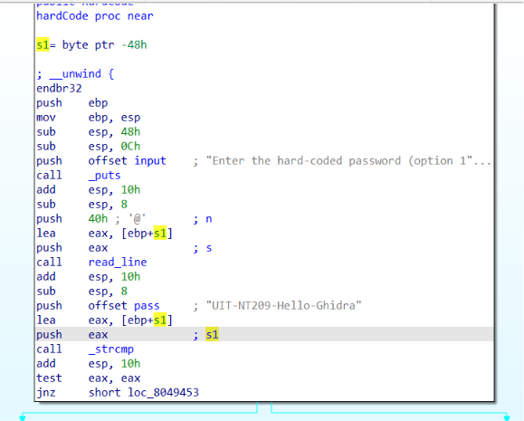
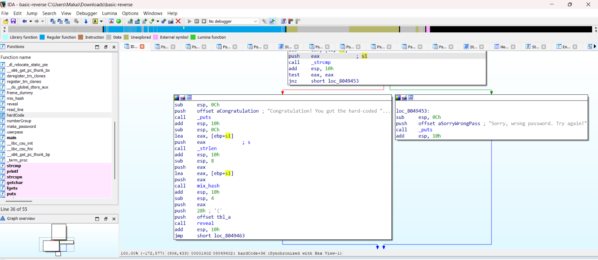
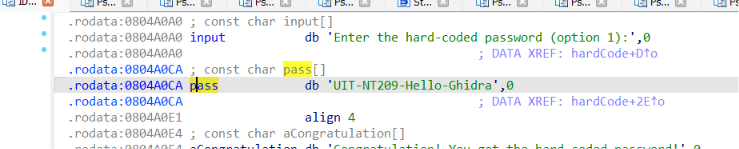
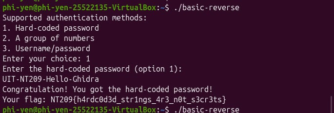
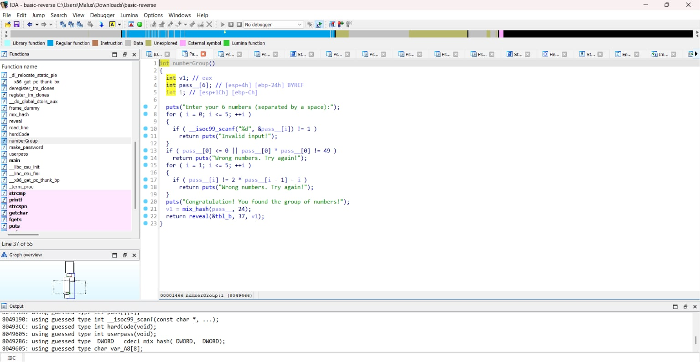
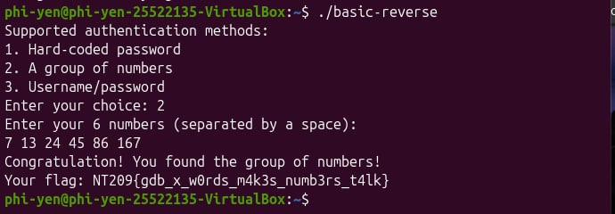
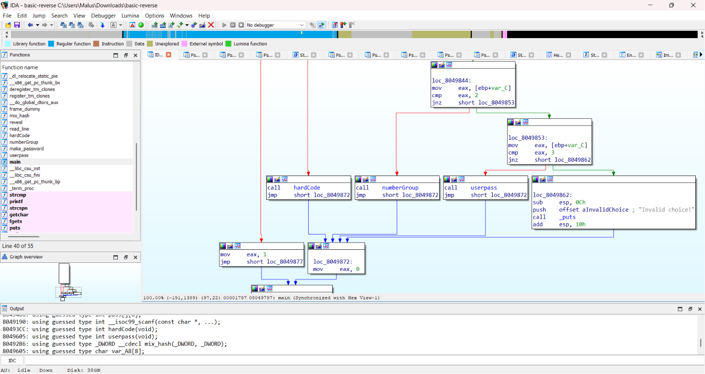
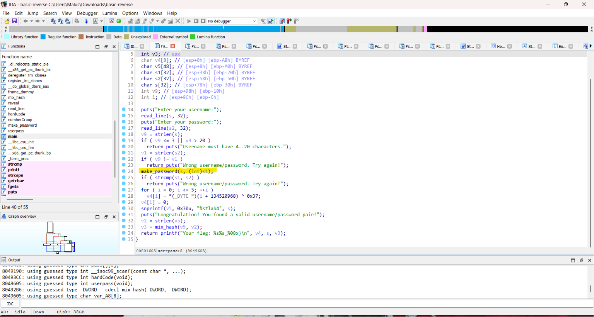
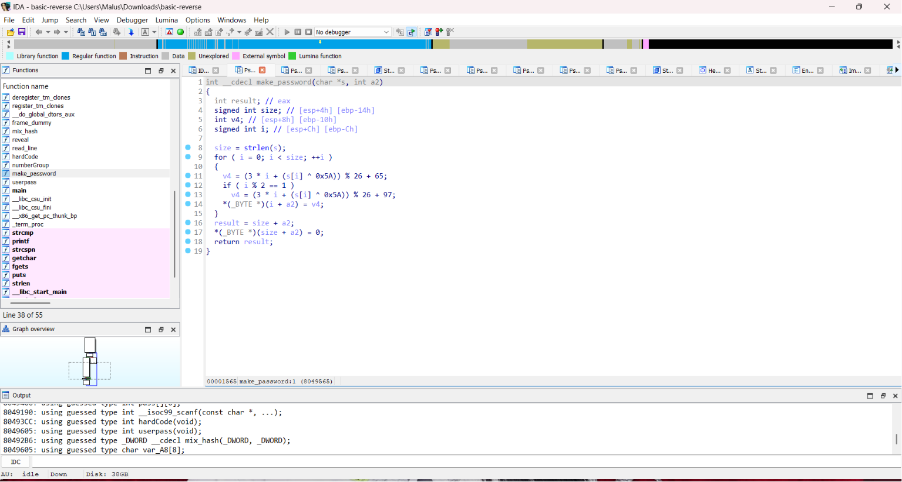
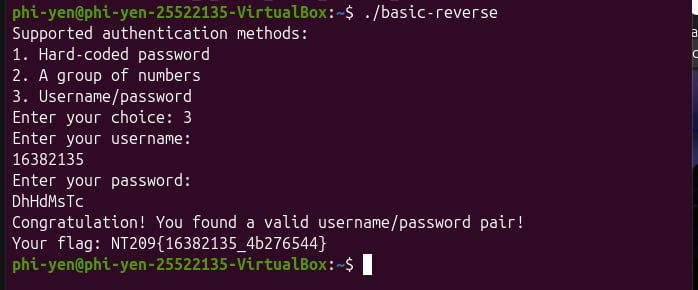

# Lab 4
## Yêu cầu 1
### Phương pháp phân tích
Mở file basic-reverse bằng IDA Pro, ở cửa sổ Function window, tìm và chọn vào tên hàm hardCore. Tại đây ta thấy các lệnh để khởi tạo stack frame, in thông báo và nhận input.
- Chỉnh s -> input
- Chỉnh s1 -> pass



Ở đây ta thấy push pass vào, sau đó là eax để thực hiện so sánh qua hàm `call _strcmp`

- Đường dẫn xanh là nếu điều kiện `jnz` đúng, còn đỏ là sai.
- Vì đường đỏ là nơi ta cần lấy => phải tìm sao cho input == pass
pass ở đây được note là `UIT-NT209-Hello-Ghidra`


> Key cần nhập: `UIT-NT209-Hello-Ghidra`

### Minh chứng

## Yêu cầu 2
### Phương pháp phân tích
Mở file basic-reverse bằng IDA Pro, ở cửa sổ Function window, tìm và chọn vào tên hàm hardCore. Tại đây ta thấy các lệnh để khởi tạo stack frame, in thông báo và nhận input.

Ta sử dụng phương pháp phân tích mã giả thông qua phím F5. 
Dựa vào mã giả, ta thấy các phép toán:

```
if (pass [0] <= 0 || pass__[0] * pass __[0] != 49 ) 
    return puts("Wrong numbers. Try again!");
```
Tại đây đang xử lí số đầu tiên. Khi này nếu số tạm gọi là x không thỏa yêu cầu x*x=49 thì báo lỗi. Từ đây có thể suy luận số đầu tiên là 7
```
for (i=1; i <= 5; ++i) {
    if (pass[i] != 2 * pass [i-1]-i) 
        return puts("Wrong numbers. Try again!");
}
```
Ở đoạn code tiếp theo, dựa vào điều kiện vòng lặp ta thấy nó đang xử lí các số còn lại theo điều kiện: 
- Nếu số đang xử lí, tạm gọi là x[i] không thỏa $x[i]=2* x[i-1]-i$ thì báo lỗi. Từ đây ta có thể suy luận các số còn lại. 



Ta có bảng tính toán sau:
|i|$x[i-1]$|$x[i]=2*x[i-1]-i$|
|---|---|---|
0||7
1|7|13
2|13|24
3|24|45
4|45|86
5|86|167

> Dựa vào phân tích trên, ta có được chuỗi số là: `7 13 24 45 86 167`

### Minh chứng

## Yêu cầu 3
### Phương pháp phân tích
Đầu tiên ta sẽ đọc workflow của file `basic-reverse` để xem hàm yêu cầu 3 là gì. Ở đây là **userpass**.



Ta có thể đọc mã giả để dễ hình dung hơn về thuật toán.



Ta chú ý có hàm **make_password** và hàm này sinh ra s1, biến để so sánh với s2 (password mà user nhập)
```
make_password(s, (int)s1);
if ( strcmp(s1, s2) )
    return puts("Wrong username/password. Try again!");
```

Nhiệm vụ của ta là tìm password tương ứng với password do hàm make_password sinh ra. Ta truy cập hàm **make_password**.



### Code tìm password
```python
#dùng hàm để tái sử dụng nếu cần thiết
def make_password(s):
    out = ""
    for i in range(len(s)):
        v = (3 * i + (ord(s[i]) ^ 0x5A)) % 26 #chuyển s[i] từ kí tự sang hex rồi thực hiện phép tính như hàm ảo trên IDA
        if i % 2 == 1:
            v += 97
        else:
            v += 65
        out += chr(v) #thêm kí tự char vào string out
    return out

print(make_password("16382135")) #DhHdMsTc
```

> Input tìm được: `DhHdMsTc`

### Minh chứng
username: `16382135`

password: `DhHdMsTc`


